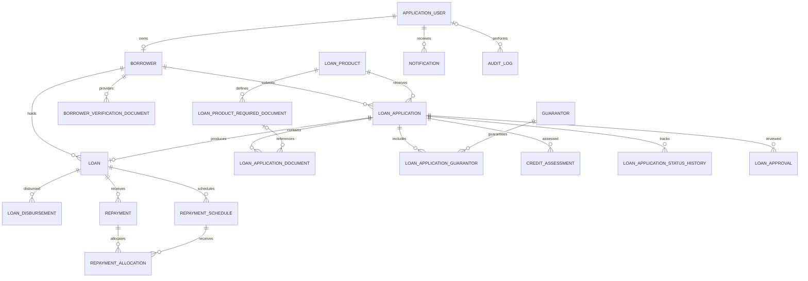

# Kredvanta Database Documentation

## 1. Introduction

Kredvanta uses Microsoft SQL Server as its relational database management system and Entity Framework Core as its Object-Relational Mapper (ORM).

The database supports borrower management, loan products, loan applications, credit assessment, loan processing, disbursements, repayments, notifications and audit logging.

Database operations are managed through `ApplicationDbContext`, which inherits from `IdentityDbContext<ApplicationUser>`.

## 2. Database Technology

| Component | Technology |
|---|---|
| Database Management System | Microsoft SQL Server |
| ORM | Entity Framework Core |
| Authentication | ASP.NET Core Identity |
| Database Context | ApplicationDbContext |
| Database Migrations | EF Core Migrations |
| Backend Language | C# |

## 3. Database Structure

The application currently defines 18 application DbSets, organised into six functional areas.

### 3.1 Borrower Management

| Entity | Description |
|---|---|
| Borrower | Stores borrower personal, identification, contact, residential, employment and financial information. |
| Guarantor | Stores guarantor information, including names, identification numbers and contact details. |

### 3.2 Loan Products

| Entity | Description |
|---|---|
| LoanProduct | Stores available lending products, including product codes, amounts, interest rates and lending terms. |
| LoanProductRequiredDocument | Defines the supporting documents required for individual loan products. |

### 3.3 Loan Applications

| Entity | Description |
|---|---|
| BorrowerVerificationDocument | Stores borrower verification document metadata. |
| LoanApplication | Stores loan requests submitted by borrowers. |
| LoanApplicationDocument | Stores metadata for documents submitted with loan applications. |
| LoanApplicationGuarantor | Associates guarantors with loan applications. |
| CreditAssessment | Stores financial information and credit assessment results. |
| LoanApplicationStatusHistory | Maintains the history of loan application status changes. |

### 3.4 Loan Processing

| Entity | Description |
|---|---|
| LoanApproval | Records loan application approval and review decisions. |
| Loan | Represents an approved and issued loan. |
| LoanDisbursement | Records loan disbursement transactions. |

### 3.5 Repayment Management

| Entity | Description |
|---|---|
| RepaymentSchedule | Stores expected loan instalments and their due dates. |
| Repayment | Stores payments received against loans. |
| RepaymentAllocation | Associates received repayments with individual repayment schedule instalments. |

### 3.6 System Management

| Entity | Description |
|---|---|
| Notification | Stores system notifications associated with users. |
| AuditLog | Maintains records of important system activities. |

## 4. ASP.NET Core Identity

Kredvanta uses ASP.NET Core Identity for authentication and user account management.

The custom `ApplicationUser` entity extends `IdentityUser`.

The database context inherits from:

`IdentityDbContext<ApplicationUser>`

Identity manages its standard authentication tables, including:

- AspNetUsers
- AspNetRoles
- AspNetUserRoles
- AspNetUserClaims
- AspNetUserLogins
- AspNetUserTokens
- AspNetRoleClaims

The application also extends user information with additional properties such as first name, last name, account activation status and account creation date.

## 5. Entity Relationships

The following relationships are configured in `ApplicationDbContext`.

### Borrower Management

- ApplicationUser to Borrower: One-to-one.
- Borrower to LoanApplication: One-to-many.
- Borrower to Loan: One-to-many.
- Borrower to BorrowerVerificationDocument: One-to-many.
- Guarantor to LoanApplicationGuarantor: One-to-many.

### Loan Products

- LoanProduct to LoanProductRequiredDocument: One-to-many.
- LoanProduct to LoanApplication: One-to-many.

### Loan Applications

- LoanApplication to LoanApplicationDocument: One-to-many.
- LoanApplication to LoanApplicationGuarantor: One-to-many.
- LoanApplication to CreditAssessment: One-to-many.
- LoanApplication to LoanApplicationStatusHistory: One-to-many.
- LoanApplication to LoanApproval: One-to-many.
- LoanApplication to Loan: One-to-one.
- LoanProductRequiredDocument to LoanApplicationDocument: One-to-many, with optionality determined by the foreign key.
- LoanApplication to AssignedOfficer: Many-to-one, optional.

### Loan Processing

- Loan to LoanDisbursement: One-to-many.
- Loan to RepaymentSchedule: One-to-many.
- Loan to Repayment: One-to-many.

### Repayment Management

- Repayment to RepaymentAllocation: One-to-many.
- RepaymentSchedule to RepaymentAllocation: One-to-many.

RepaymentAllocation acts as an associative entity between Repayment and RepaymentSchedule.

### System Management

- ApplicationUser to Notification: One-to-many.
- ApplicationUser to AuditLog: One-to-many, with an optional user reference.

Several operational entities also reference ApplicationUser for accountability, including credit assessments, approvals, disbursements, repayments and uploaded documents.

## 6. Entity Relationship Diagram

The following Mermaid diagram represents the principal configured lending relationships.



**Diagram note:** This is a relationship-level ERD, not a complete column-level schema. It excludes several operational user-reference relationships for readability. The exact table names, primary key types, foreign key nullability and inherited base entity fields should be checked against the model classes and generated migrations.

## 7. Data Integrity and Constraints

Kredvanta uses Entity Framework Core configuration to enforce data integrity.

### 7.1 Unique Indexes

The following unique indexes are explicitly configured:

| Entity | Unique field or combination |
|---|---|
| Borrower | BorrowerNumber |
| Borrower | IdentificationType + NationalIdNumber |
| Borrower | ApplicationUserId (when not null) |
| LoanProduct | ProductCode |
| LoanApplication | ApplicationNumber |
| Loan | LoanNumber |
| Loan | LoanApplicationId |
| Repayment | ReceiptNumber |
| Repayment | ExternalTransactionId (when not null) |
| RepaymentSchedule | LoanId + InstallmentNumber |
| RepaymentAllocation | RepaymentId + RepaymentScheduleId |
| LoanApplicationGuarantor | LoanApplicationId + GuarantorId |

### 7.2 Financial Precision

Financial properties use explicit decimal precision to preserve monetary accuracy.

- Monetary amounts: decimal(18,2).
- Interest rates and ratios: decimal(9,4).

### 7.3 Check Constraints

Loan product and loan financial rules include:

- Minimum loan amount must not be negative.
- Maximum loan amount must not be below the minimum.
- Annual interest rate must not be negative.
- Minimum loan term must be greater than zero.
- Maximum loan term must not be below the minimum.
- Loan principal, outstanding balance and total repayable must not be negative.

### 7.4 Indexing

Additional indexes support common lookup and operational queries, including:

- Borrower phone number.
- Borrower and loan application status.
- Loan application status history dates.
- User notification read status.
- Audit log action dates.
- Borrower verification document types.

## 8. Referential Integrity and Delete Behaviours

The application explicitly configures the following delete behaviours:

| Relationship | Delete behaviour |
|---|---|
| ApplicationUser – Borrower | SetNull |
| LoanProduct – RequiredDocument | Restrict |
| Borrower – LoanApplication | Restrict |
| LoanProduct – LoanApplication | Restrict |
| LoanApplication – Loan | Restrict |
| LoanApplication – Supporting Documents | Restrict |
| LoanApplication – Guarantors | Restrict |
| LoanApplication – Credit Assessments | Restrict |
| LoanApplication – Approvals | Restrict |
| LoanApplication – Status History | Restrict |
| Loan – Disbursements | Restrict |
| Loan – Repayment Schedules | Restrict |
| Loan – Repayments | Restrict |
| Repayment – Allocations | Restrict |
| RepaymentSchedule – Allocations | Restrict |
| Borrower – Verification Documents | Cascade |
| User – Audit Logs | SetNull |

Other user references use the delete behaviours configured in their respective relationship mappings.

## 9. Database Migrations

Entity Framework Core migrations are used to manage changes to the database schema.

Common commands:

Create a migration:

```powershell
Add-Migration MigrationName
```

Apply migrations:

```powershell
Update-Database
```

Remove the latest unapplied migration:

```powershell
Remove-Migration
```

The migration files are maintained in the application's `Data/Migrations` directory.

## 10. Database Security

Database security considerations include:

- Secure connection string management.
- Restricted database access.
- Authentication and role-based authorization.
- Secure storage of uploaded documents.
- Protection of borrower identification and financial information.
- Audit logging of important operations.
- Regular database backups.
- Controlled access to financial records.

## 11. Future Database Enhancements

Potential future improvements include:

- Payment reconciliation.
- Transaction ledger management.
- Loan restructuring records.
- Automated payment processing.
- Enhanced financial reporting.
- Additional fraud detection and monitoring records.

---

**Project:** Kredvanta  
**Database:** Microsoft SQL Server  
**ORM:** Entity Framework Core  
**Context:** ApplicationDbContext  
**Documentation Status:** Based on the current ApplicationDbContext configuration. Full physical schema verification remains subject to reviewing entity classes and migrations.